<p align="center">
  
</p>

<p align="center">
  <a href="https://github.com/sindresorhus/awesome"></a>
  <a href="https://github.com/ishandutta2007/Awesome-Environment-Variable-Managers/stargazers"></a>
  <a href="https://github.com/ishandutta2007/Awesome-Environment-Variable-Managers/network/members"></a>
  <a href="https://github.com/ishandutta2007/Awesome-Environment-Variable-Managers/blob/main/LICENSE"></a>
  <a href="https://github.com/ishandutta2007/Awesome-Environment-Variable-Managers/pulls"></a>
  <a href="https://github.com/ishandutta2007/Awesome-Environment-Variable-Managers"></a>
</p>

---

# 🔐 Awesome Environment Variable Managers

> **A curated directory of SaaS platforms, self-hosted secrets managers, encrypted `.env` tools, and cloud key vaults.**  
> *Track, synchronize, rotate, and inject credentials safely across developer local environments, CI/CD pipelines, Kubernetes, and multi-cloud architectures.*

**Last updated:** October 2026

Modern software delivery demands zero-trust credential hygiene. Storing API keys, database credentials, cryptographic certificates, and cloud tokens in plaintext `.env` files or hardcoded configuration creates major attack surfaces. This guide indexes the premier **SaaS platforms** and **open-source projects** for environment variable and secrets management, audited with starting pricing tiers, free tier thresholds, company valuations, and repository star metrics.

---

## 📑 Table of Contents

- [📊 Sector Overview & Market Dynamics](#-sector-overview--market-dynamics)
- [☁️ SaaS & Hosted Platforms](#️-saas--hosted-platforms)
  - [📋 SaaS Comparison Matrix](#-saas-comparison-matrix)
  - [🔍 Detailed SaaS Platform Breakdown](#-detailed-saas-platform-breakdown)
- [🔓 Open-Source GitHub Projects](#-open-source-github-projects)
  - [⭐ Open-Source Projects Ranked by Stars](#-open-source-projects-ranked-by-stars)
  - [🛠️ Architectural Blueprints & Stacks](#️-architectural-blueprints--stacks)
- [🎯 Buyer's Guide & Evaluation Criteria](#-buyers-guide--evaluation-criteria)
- [🤝 How to Contribute](#-how-to-contribute)
- [⚠️ Disclaimer](#️-disclaimer)

---

## 📊 Sector Overview & Market Dynamics

The global **secrets management and environment configuration market** is valued at approximately **$2.43 billion to $3.5 billion in 2025/2026**, projected to surge past **$4.8 billion by 2030** at a Compound Annual Growth Rate (CAGR) of **15%–18%**. Growth is driven by the expansion of cloud-native microservices, automated CI/CD pipelines, regulatory audits (SOC 2, ISO 27001, HIPAA), and the rapid proliferation of non-human workload identities (AI agents, containers, microservices) which outnumber human users by more than 40-to-1.

**Market Concentration & Fragmentation Dynamics:**
The sector is **moderately fragmented** rather than a winner-take-all monopoly. While public cloud hyperscalers (Microsoft Azure, Google Cloud, AWS) capture immense baseline adoption for cloud-native workloads, and legacy PAM titans like CyberArk and HashiCorp/IBM dominate complex enterprise perimeters, specialized developer-first platforms (Doppler, Infisical, 1Password, Bitwarden, Akeyless) and open-source ecosystems (Vault, OpenBao, SOPS, mise) continue to capture significant developer mindshare. Modern engineering organizations increasingly operate hybrid setups—combining cloud-native KMS with developer-friendly sync CLIs and GitOps secret controllers.

---

## ☁️ SaaS & Hosted Platforms

### 📋 SaaS Comparison Matrix

*The table below compares commercial SaaS secret management solutions, sorted in descending order by **Company Size / Valuation / Market Capitalization**.*

| 🏷️ Product / Platform | 🏢 Vendor / Parent Company | 📈 Company Size (Valuation / MCap) | 💵 Starting Paid Tier Pricing | 🎁 Free Tier Limits / Trial Scope | 🚀 Primary Focus & Key Strength |
| :--- | :--- | :--- | :--- | :--- | :--- |
| **[Azure Key Vault](https://azure.microsoft.com/en-us/products/key-vault/)** | Microsoft | **~$3.1 Trillion** *(Market Cap)* | **$0.03** per 10,000 standard secret transactions *(HSM: $3.20/hr)* | **30-day trial with $200 credits**; 12 months free tier covers standard secrets and key transactions | Native Azure Entra ID integration; FIPS 140-2 Level 2/3 HSM compliance. |
| **[Google Secret Manager](https://cloud.google.com/secret-manager)** | Alphabet / Google Cloud | **~$2.1 Trillion** *(Market Cap)* | **$0.06** per active secret version/mo + **$0.03** per 10,000 API operations | **Free forever:** 6 active secret versions, 10,000 access operations/mo, 3 rotation notifications/mo *(+$300 90-day GCP trial)* | Native GCP IAM integration, global replication, and Cloud Run/GKE mounts. |
| **[AWS Secrets Manager](https://aws.amazon.com/secrets-manager/)** | Amazon / AWS | **~$1.9 Trillion** *(Market Cap)* | **$0.40** per secret/month + **$0.05** per 10,000 API access calls | **30-day free trial** for each newly created secret + up to 10,000 free API calls per secret | Native AWS RDS, Redshift, and DocumentDB automatic credential rotation via Lambda. |
| **[CyberArk Conjur Cloud](https://www.cyberark.com/products/secrets-management/)** | CyberArk *(NASDAQ: CYBR)* | **~$12.0 Billion** *(Market Cap)* | **$40.00** per workload identity/year *(Base enterprise packages start ~$1,200/yr)* | **30-day guided enterprise PoC trial** for up to 5 workloads; unlimited free use via Conjur Open Source (OSS) | Enterprise Privileged Access Management (PAM) and compliance-heavy machine identities. |
| **[1Password Secrets Automation](https://1password.com/developers/secrets-management/)** | 1Password | **~$6.8 Billion** *(Valuation - Series C)* | **$24.95/month** *(Teams Starter Pack up to 10 users)* or **$8.99/user/month** *(Business)* | **14-day free trial** of Business plan with full access to service accounts, CLI, and vault items | Seamlessly unifies human password management with automated machine service accounts. |
| **[HCP Vault Dedicated](https://www.hashicorp.com/products/vault)** | HashiCorp / IBM | **$6.4 Billion** *(Acquisition valuation; IBM ~$200B MCap)* | **$0.62/cluster/hour** *(~$450/month for Development tier)*; Prod from **$1.58/hr** | **30-day free trial with $50 HCP credits** (runs a Dev cluster for ~80 hours free) | Industry-standard dynamic database credentials, encryption-as-a-service, and Terraform sync. |
| **[Bitwarden Secrets Manager](https://bitwarden.com/products/secrets-manager/)** | Bitwarden | **~$800 Million** *(Valuation - Series B)* | **$6.00/user/month** *(Teams plan, includes 20 machine accounts + $0.50/extra machine)* | **Free forever:** 2 user seats, 3 machine/service accounts, 3 projects, and unlimited secrets storage | Affordable, open-source-backed secrets automation extending trusted password manager vaults. |
| **[Akeyless Vaultless Platform](https://www.akeyless.io/)** | Akeyless | **~$350 Million** *(Valuation - Series B)* | **$40.00/month** *(Entry partner bundle; scalable custom tiers from ~$15/client/mo)* | **Free forever:** 5 clients, 500 static secrets, 5 dynamic secrets, 5 rotated secrets, 5 access roles | Patented Distributed Fragments Cryptography (DFC) with zero-knowledge "Vaultless" architecture. |
| **[Doppler](https://www.doppler.com/)** | Doppler | **~$150 Million** *(Valuation - Series A)* | **$21.00/user/month** *(Team plan; extra Developer seats at $8/user/mo)* | **Free forever:** up to 3 users, 10 projects, 4 environments/project, 5 config syncs, 50 service tokens | Zero-downtime dual-active secret rotation and instant two-way sync to 50+ cloud providers. |
| **[Infisical Cloud](https://infisical.com/)** | Infisical | **~$40 Million** *(Valuation - Seed/Series A)* | **$20.00/identity/month** *(Pro plan billed annually; or $23 billed monthly)* | **Free forever:** up to 5 identities (human/machine), 3 projects, 3 environments/project; unlimited secrets | Developer-first UI, comprehensive SDKs, secret leak prevention, and 100% self-hostable core. |

---

### 🔍 Detailed SaaS Platform Breakdown

- **[Azure Key Vault](https://azure.microsoft.com/en-us/products/key-vault/)**  
  🛡️ *Microsoft's Cloud Security Anchor*  
  Provides hardware security module (HSM) backed storage for cryptographic keys, certificates, and application secrets. Tight integration with Microsoft Entra ID (formerly Azure Active Directory) and Managed Identities enables applications running on Azure VMs, App Services, or AKS to access secrets without maintaining hardcoded bootstrap credentials.

- **[Google Secret Manager](https://cloud.google.com/secret-manager)**  
  🌐 *GCP Native Global Secrets Engine*  
  A managed secrets repository designed for Google Cloud environments. Features immutable secret versioning, global automatic multi-region replication, and granular Cloud IAM policies. Integrates out of the box with Cloud Build, Cloud Run, GKE, and Cloud Functions.

- **[AWS Secrets Manager](https://aws.amazon.com/secrets-manager/)**  
  ⚡ *Automated Cloud Rotation for AWS Stacks*  
  AWS's flagship secrets store. Out of the box, it provides built-in automated rotation for Amazon RDS (MySQL, PostgreSQL, Aurora), Amazon Redshift, and Amazon DocumentDB via pre-configured AWS Lambda functions. Best for teams with deep AWS-centric workloads.

- **[CyberArk Conjur Cloud](https://www.cyberark.com/products/secrets-management/)**  
  🏢 *Enterprise PAM & Machine Identity Security*  
  Tailored for large-scale enterprise environments with stringent auditing and compliance needs. Enforces strict role-based access control (RBAC), multi-factor machine authentication, and real-time privileged session tracking across Kubernetes clusters, mainframes, and multi-cloud footprints.

- **[1Password Secrets Automation](https://1password.com/developers/secrets-management/)**  
  🔑 *Bridge Between Human & Machine Credentials*  
  Allows organizations already using 1Password to bridge their human password vaults with developer pipelines. Uses local 1Password Connect servers and service accounts to securely pull tokens, SSH keys, and database passwords into CI/CD runners (GitHub Actions, GitLab CI) and Kubernetes pods.

- **[HashiCorp Vault (HCP Vault Dedicated)](https://www.hashicorp.com/products/vault)**  
  👑 *The Industry Reference for Dynamic Secrets*  
  The cloud-managed version of HashiCorp Vault operated by HashiCorp/IBM. Rather than simply storing static passwords, Vault generates just-in-time, short-lived credentials for PostgreSQL, MongoDB, AWS IAM, and SSH that expire automatically. Eliminates manual rotation entirely.

- **[Bitwarden Secrets Manager](https://bitwarden.com/products/secrets-manager/)**  
  🔒 *Open-Source Heritage Developer Secrets*  
  Extends the beloved open-source Bitwarden password management ecosystem to machine credentials and developer environments. Features a streamlined web UI, command-line interface, SDKs for Python/Node/Go, and end-to-end zero-knowledge encryption.

- **[Akeyless Platform](https://www.akeyless.io/)**  
  🧩 *Vaultless SaaS with Fragment Cryptography*  
  Pioneers a "Vaultless" secret management paradigm using Distributed Fragments Cryptography (DFC). Secrets are encrypted using key shares split across multiple cloud regions, guaranteeing that neither cloud providers nor Akeyless itself can access customer plaintext secrets.

- **[Doppler](https://www.doppler.com/)**  
  🚀 *Developer Velocity & Zero-Downtime Rotation*  
  Designed from the ground up for developer productivity. Features Rotated Secrets (keeping old and new keys active simultaneously during rotation), dynamic branching for staging/preview environments, and two-way automated sync to Vercel, Netlify, AWS, Render, Heroku, and GitHub Actions.

- **[Infisical Cloud](https://infisical.com/)**  
  ⭐ *Developer-First Open-Source Backed Cloud*  
  The hosted edition of the open-source Infisical platform. Boasts an intuitive UI, comprehensive CLI with local process injection (`infisical run --`), Git secret scanning, native Kubernetes operators, and end-to-end client-side encryption.

---

## 🔓 Open-Source GitHub Projects

### ⭐ Open-Source Projects Ranked by Stars

*All repositories below are strictly sorted in descending order by **GitHub Star Count**, featuring direct links to stargazers and white social star badges.*

1. **[HashiCorp Vault](https://github.com/hashicorp/vault)** [](https://github.com/hashicorp/vault/stargazers)  
   🏛️ *The Reference Implementation for Dynamic Secrets & Encryption as a Service*  
   Dynamic secrets engine mints short-lived database and cloud credentials on demand, eliminating static passwords. Provides built-in PKI certificate authorities, transit encryption, and extensive enterprise auth backends (OIDC, AppRole, Kubernetes).  
   *License:* BSL 1.1 • *Language:* Go

2. **[mise-en-place](https://github.com/jdx/mise)** [](https://github.com/jdx/mise/stargazers)  
   ⚡ *Polyglot Runtime & Directory-Scoped Environment Variable Manager*  
   A lightning-fast modern alternative to `asdf` and `direnv` built in Rust. Automatically manages project-specific environment variables (`.env`, `mise.toml`), secret vaults, and CLI runtime versions (Node, Python, Go, Ruby) seamlessly as you change directories.  
   *License:* MIT • *Language:* Rust

3. **[Infisical](https://github.com/Infisical/infisical)** [](https://github.com/Infisical/infisical/stargazers)  
   🌟 *Complete Self-Hosted Secrets Management Platform*  
   The fastest-growing open-source alternative to HashiCorp Vault and Doppler. Offers an exceptional web dashboard, end-to-end secret encryption, automatic sync to 30+ cloud platforms, Kubernetes secret operator, CLI secret injection, and secret leak prevention hooks.  
   *License:* MIT / EE • *Language:* TypeScript / Go

4. **[SOPS (Secrets OPerationS)](https://github.com/getsops/sops)** [](https://github.com/getsops/sops/stargazers)  
   🛡️ *GitOps-Native Encrypted Config Files*  
   Mozilla-originated encryption utility for YAML, JSON, ENV, and INI configuration files. Encrypts only the values while leaving keys in plaintext so diffs remain human-readable in Git. Integrates with AWS KMS, GCP KMS, Azure Key Vault, HashiCorp Vault, and `age`/PGP keys.  
   *License:* MPL 2.0 • *Language:* Go

5. **[dotenv](https://github.com/motdotla/dotenv)** [](https://github.com/motdotla/dotenv/stargazers)  
   📦 *The Original & Foundational Environment Loader*  
   The zero-dependency module that started the `.env` movement. Loads variables from `.env` files directly into `process.env`. Universally ported across Python, Ruby, PHP, Rust, Go, and Java ecosystems.  
   *License:* BSD-2-Clause • *Language:* JavaScript

6. **[direnv](https://github.com/direnv/direnv)** [](https://github.com/direnv/direnv/stargazers)  
   📂 *Unclutter Your Shell with Directory-Scoped Environment Switching*  
   Shell extension that hooks into bash, zsh, fish, and tcsh to load and unload environment variables based on your current working directory. Reads `.envrc` files, isolates project environments, and cleans them up upon `cd ..`.  
   *License:* MIT • *Language:* Go

7. **[Bitnami Sealed Secrets](https://github.com/bitnami-labs/sealed-secrets)** [](https://github.com/bitnami-labs/sealed-secrets/stargazers)  
   ☸️ *One-Way Asymmetric Encryption for Kubernetes GitOps*  
   Solves "Secrets in Git" for Kubernetes. Encrypts standard Kubernetes Secrets into custom `SealedSecret` resources using the cluster controller's public key. Safe to push to public or private Git repositories; only the in-cluster controller can decrypt them.  
   *License:* Apache 2.0 • *Language:* Go

8. **[AWS Vault](https://github.com/99designs/aws-vault)** [](https://github.com/99designs/aws-vault/stargazers)  
   🔐 *Secure Local Storage for AWS Credentials & MFA Session Tokens*  
   Stores IAM credentials in your operating system's secure keystore (macOS Keychain, Windows Credential Manager, Secret Service / KWallet) instead of plaintext `~/.aws/credentials`. Generates temporary STS session tokens injected directly into execution environments.  
   *License:* MIT • *Language:* Go

9. **[OpenBao](https://github.com/openbao/openbao)** [](https://github.com/openbao/openbao/stargazers)  
   🔓 *Linux Foundation Open-Governance Fork of HashiCorp Vault*  
   Maintained under the Linux Foundation Edge to guarantee community stewardship following HashiCorp's license change. Drop-in compatible with Vault's APIs, dynamic database secrets engines, Kubernetes auth, and CLI commands.  
   *License:* MPL 2.0 • *Language:* Go

10. **[External Secrets Operator (ESO)](https://github.com/external-secrets/external-secrets)** [](https://github.com/external-secrets/external-secrets/stargazers)  
    🔄 *Universal Kubernetes Secret Synchronization Controller*  
    Kubernetes operator that continuously synchronizes secrets from external APIs (AWS Secrets Manager, HashiCorp Vault, Google Secret Manager, Azure Key Vault, Infisical, 1Password) into native Kubernetes `Secret` resources.  
    *License:* Apache 2.0 • *Language:* Go

11. **[dotenvx](https://github.com/dotenvx/dotenvx)** [](https://github.com/dotenvx/dotenvx/stargazers)  
    🔒 *Encrypted .env Files with Public-Key Cryptography*  
    From the creator of original `dotenv`. Provides built-in symmetric encryption for `.env` files (`dotenvx encrypt`), allowing secure commits to version control. Supports environment-specific overrides (`.env.production`), multi-cloud decryption keys, and pre-commit hooks.  
    *License:* BSD-3-Clause • *Language:* JavaScript / Go

12. **[Teller](https://github.com/tellerops/teller)** [](https://github.com/tellerops/teller/stargazers)  
    🧰 *Multi-Provider Developer Secret Proxy & CLI Runner*  
    A single unified CLI to fetch secrets on the fly from multiple backends (HashiCorp Vault, AWS SSM, Google Secret Manager, Doppler, 1Password, etcd) and inject them directly into process memory without writing any files to disk.  
    *License:* Apache 2.0 • *Language:* Go

13. **[envchain](https://github.com/sorah/envchain)** [](https://github.com/sorah/envchain/stargazers)  
    🛡️ *Inject Environment Variables Directly from OS Keystores*  
    Stores sensitive environment variables (such as AWS keys, GitHub PATs, and OpenAI tokens) in macOS Keychain or D-Bus Secret Service. Sets them into environment variables only for the executed sub-command: `envchain aws aws s3 ls`.  
    *License:* MIT • *Language:* C

14. **[CyberArk Conjur Open Source](https://github.com/cyberark/conjur)** [](https://github.com/cyberark/conjur/stargazers)  
    🏢 *Open Source Machine Identity & DevOps Secrets Engine*  
    The community edition of CyberArk Conjur. Provides robust REST APIs, client libraries, SPIFFE/SPIRE integrations, and Kubernetes sidecar injection to authenticate non-human workloads without storing static access tokens.  
    *License:* Apache 2.0 • *Language:* Ruby / Go

---

### 🛠️ Architectural Blueprints & Stacks

Depending on your security maturity and operational posture, standard industry patterns include:

```
[Local Dev Machine]             [Version Control (Git)]          [Production Cluster]
   mise / direnv                   SOPS / dotenvx                   External Secrets Operator
 (Directory Context)            (Encrypted .env in Git)          (Kubernetes Sync Controller)
         │                                │                                    │
         ▼                                ▼                                    ▼
┌────────────────────────────────────────────────────────────────────────────────────────┐
│                   Centralized Secret Vault (SaaS or Self-Hosted)                      │
│            • Infisical (Self-Hosted / SaaS)        • HashiCorp Vault / OpenBao        │
│            • Doppler (Managed Cloud)               • AWS / Azure / GCP Secret Store   │
└────────────────────────────────────────────────────────────────────────────────────────┘
```

- **Lightweight GitOps Stack:** Store encrypted `.env` files in git with **[SOPS](https://github.com/getsops/sops)** or **[dotenvx](https://github.com/dotenvx/dotenvx)**; decrypt at runtime in CI/CD using cloud KMS keys.
- **Enterprise Kubernetes Stack:** Host **[OpenBao](https://github.com/openbao/openbao)** or **[Infisical](https://github.com/Infisical/infisical)**, using **[External Secrets Operator](https://github.com/external-secrets/external-secrets)** to mount credentials into pods as native Kubernetes Secrets or RAM volumes.
- **Developer Local Workflow:** Use **[mise](https://github.com/jdx/mise)** or **[direnv](https://github.com/direnv/direnv)** paired with **[AWS Vault](https://github.com/99designs/aws-vault)** or **[envchain](https://github.com/sorah/envchain)** to ensure no plaintext tokens reside in bash histories or terminal configs.

---

## 🎯 Buyer's Guide & Evaluation Criteria

| 🧭 Evaluation Pillar | 🔍 Key Questions & Considerations | 💡 Recommended Tools |
| :--- | :--- | :--- |
| **Data Sovereignty & Self-Hosting** | Must your secrets reside in an air-gapped network or private VPC to satisfy compliance (HIPAA, PCI-DSS, FedRAMP)? | **Infisical (Self-Hosted)**, **OpenBao**, **HashiCorp Vault** |
| **Dynamic Secrets vs Static Key-Value** | Do you need just-in-time credential generation with automatic database lease expiration, or static sync? | **HashiCorp Vault**, **OpenBao**, **Akeyless** |
| **Developer Velocity & Low Ops** | Does your engineering team lack dedicated platform engineers to manage high-availability clusters? | **Doppler**, **Infisical Cloud**, **1Password** |
| **GitOps & Code Review Integration** | Do you prefer keeping encrypted secrets committed directly beside application code in Git? | **SOPS**, **Bitnami Sealed Secrets**, **dotenvx** |
| **Kubernetes Native Orchestration** | Are you synchronizing secrets into thousands of microservice pods across multi-cluster environments? | **External Secrets Operator**, **Vault Agent Injector** |

---

## 🤝 How to Contribute

We welcome additions, updates, and corrections from the community!

1. 🍴 **Fork the repository** on GitHub.
2. 🌿 **Create a descriptive branch:** `git checkout -b add-tool-name`.
3. 📝 **Add or update the project:**
   - For **SaaS**: Include product name, official website, company valuation/size, explicit starting tier price, and explicit free tier/trial limits.
   - For **Open-Source**: Include official GitHub link, social star badge `[](https://github.com/owner/repo/stargazers)`, brief description, license, and sort by star count.
4. 🚀 **Submit a Pull Request** with a brief summary of why the tool should be indexed.

---

## ⚠️ Disclaimer

- This list is a **community-curated index** and does not constitute a formal endorsement or security warranty.
- Secret management architectures carry critical security risks. Always conduct independent security audits, evaluate cryptographic backends, test disaster recovery (e.g., Vault unseal processes), and enforce least-privilege RBAC.
- Pricing, free tier limits, and corporate valuations change frequently; please check official vendor websites for real-time commercial terms.

---

<p align="center">
  <b>Built with ❤️ by and for the DevOps, Platform Engineering &amp; CyberSecurity Community.</b><br>
  <i>Never commit plaintext secrets. Keep your environments encrypted, automated, and audited.</i>
</p>
